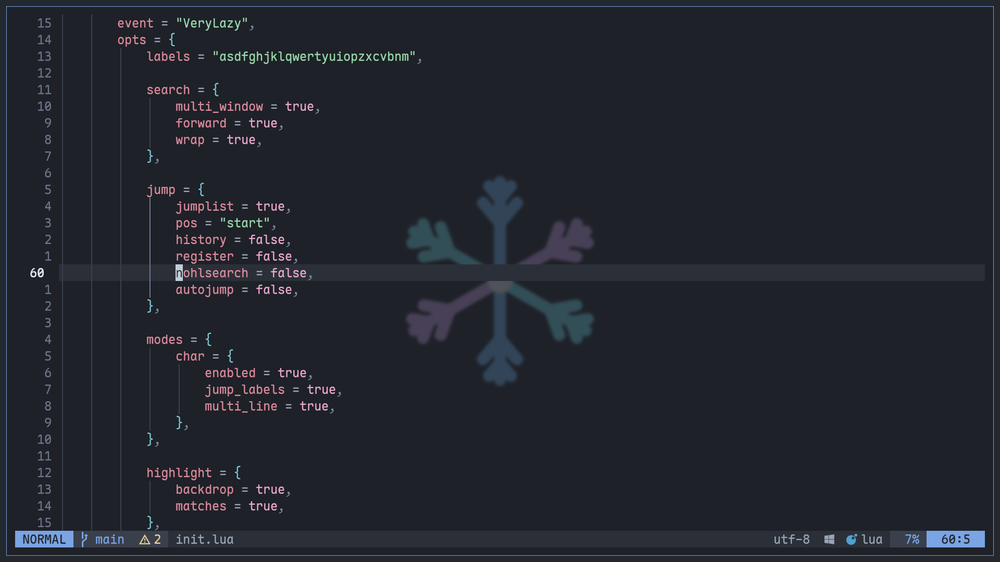

# nvim, w0x7y special

my neovim config. one `init.lua`, one plugin file, [rime](https://github.com/w0x7y/rime) colors and [revo](https://github.com/if-not-nil/revo) support

<p align="center">


</p>

<p align="center">
<a href="#install">install</a> |
<a href="#keys">keys</a> |
<a href="#whats-in-it">what's in it</a> |
<a href="#revo">revo</a> |
<a href="#layout">layout</a>
</p>

### install

needs neovim `0.12`+, git and a nerd font

```sh
git clone https://github.com/w0x7y/w0x7y.nvim ~/.config/nvim
nvim
```

lazy.nvim installs itself and every plugin on first start\
mason then installs the language servers and formatters

<details>
<summary>~ other programs it calls</summary>

<br>

| program | for |
|---|---|
| `fd` | `<leader>ff` |
| `rg` | `<leader>fg` |
| `tree-sitter` cli and a c compiler | building parsers |
| `revo` | the revo lsp, from `$PATH` or `~/.local/bin/revo` |
| a python venv in `~/.local/share/better-sql-venv` | better-sql.nvim |

</details>

### keys

leader is `<space>`

| key | does |
|---|---|
| `<leader>ff` | find files |
| `<leader>fg` | live grep |
| `<leader>fb` | buffers |
| `<leader>fk` | search every keymap |
| `<leader>e` | file explorer |
| `<leader>jf` | format the file or selection |
| `s` | flash jump |
| `S` | flash select a treesitter node |
| `gd` | go to definition |
| `grr` | references, in the picker |

the other lsp keys are neovim's own: `grn` rename, `gra` code action, `gri` implementation, `gO` symbols, `K` hover

in completion, `<Tab>` and `<S-Tab>` move through items and snippet fields\
`<CR>` only confirms an item you picked, `<C-space>` shows its docs\
snippets stay out of the menu. type `` ` `` before a word, like `` `for ``, to list only snippets. the backtick goes away when one expands

### what's in it

~ [rime](https://github.com/w0x7y/rime) colorscheme, switch variants in `lua/plugins/rime.lua`\
~ snacks.nvim for the picker, explorer, dashboard, smooth scroll and indent guides\
~ the picker sits on the last line like `:find`, its height fits the number of results\
~ every prompt uses that same bottom bar: lsp rename, code actions, and the explorer's rename, add, copy and delete\
~ blink.cmp with luasnip and friendly-snippets\
~ mason installs clangd, omnisharp, lua_ls, pyright, rust_analyzer, html, cssls, ts_ls, eslint and jsonls\
~ conform formats on save with stylua, csharpier, clang-format, black, rustfmt and prettier, all at 4 spaces\
~ diagnostics show in full under the cursor's line and nowhere else\
~ the command bar hides itself. it comes back for a command or message and hides after 2 idle seconds. no "press ENTER" prompts\
~ lualine shows `recording @q` while a macro records\
~ treesitter, lualine, gitsigns, autopairs, ts-autotag, render-markdown, lazydev\
~ [better-sql.nvim](https://github.com/w0x7y/better-sql.nvim) with a `supabase` connection read from `~/.pg_service.conf`

### revo

`lua/revo.lua` sets up [revo](https://github.com/if-not-nil/revo) by hand

~ `.rv`, `.revo` and files with a revo shebang get the `revo` filetype\
~ `revo lsp` runs as the language server, with inlay hints on\
~ the parser builds from `~/.local/share/revo/tree-sitter-revo-current`\
~ [revofmt.nvim](https://github.com/w0x7y/revofmt.nvim) formats on save\
~ 43 snippets in `snippets/revo.json`, like `fn`, `match`, `test`, `class` and `cli`

> [!TIP]
> set `vim.g.revo_executable` or `vim.g.revo_grammar_path` before `require("revo")` to use another binary or grammar

### layout

```text
init.lua              options, keymaps, lazy bootstrap
lua/plugins/init.lua  every plugin except the colorscheme
lua/plugins/rime.lua  colorscheme
lua/revo.lua          revo filetype, lsp and parser
snippets/             revo snippets for luasnip
```

_license: [mit](./LICENSE)_
